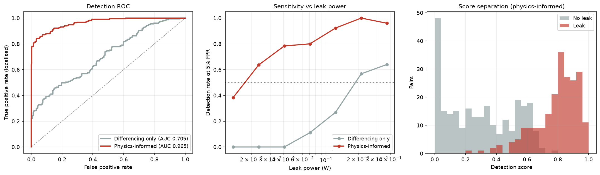
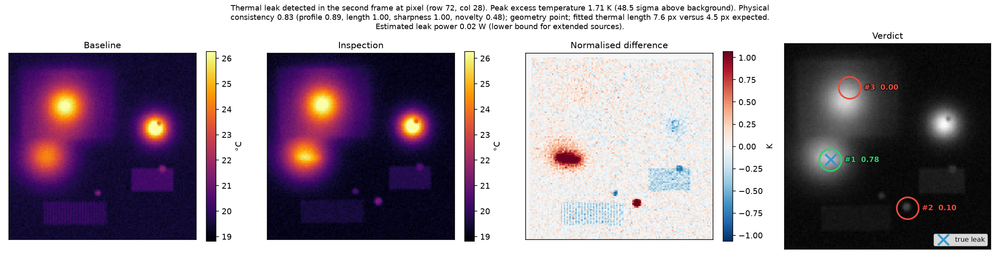

# Physics as a Falsification Test for Quantum-Limited Thermal Leak Detection

Code, data-generating simulator and result files for the working paper
**"Physics as a Falsification Test for Quantum-Limited Thermal Leak Detection"**
by Om Mishra and Gaurvit Dangayach (School of Computing, SRM Institute of
Science and Technology; preprint, 2026). The Python package is called `thermalleak`.

**Paper (preprint):** https://doi.org/10.5281/zenodo.24010713

**Status, stated plainly.** Every headline result here comes from a calibrated
simulator, or from real thermal backgrounds with simulated leaks injected into
them. A real leak of known power has not yet been imaged, so nothing in this
repository is evidence about a real camera. `PROTOCOL_real_data.md` describes
the experiment that would supply it.

## Reproduce the paper's numbers

```bash
python3 -m venv .venv && source .venv/bin/activate
pip install -r requirements.txt -r requirements-learn.txt
pytest tests/ -q                                   # expect 34 passed

python3 scripts/run_evaluation.py --n-pairs 500 --seed 11 --outdir /tmp/eval   # the core ablation
python3 scripts/run_ablation_ci.py --outdir /tmp/abl                          # error bars, five datasets   (~5 min)
python3 scripts/run_detector_sweep.py --outdir /tmp/sweep                     # detector noise vs detection limit (~12 min)
python3 scripts/run_constrained_learning.py --transfer-fields 0.16 0.64 --outdir /tmp/learn   # learning and transfer (~8 min)
python3 scripts/run_robustness_heldout.py robustness --outdir /tmp/rob        # wrong material constants
python3 scripts/run_robustness_heldout.py heldout --outdir /tmp/held          # fresh data and a new material
python3 scripts/make_figures.py                                               # figures from results/*.json
```

Write to a scratch folder (as above) so the stored reference files in
`results/` are not overwritten. The physics arm is not bit-reproducible across
SciPy versions (the curve fit in `score.py` moves the AUC by up to about 0.012);
compare against a run on your own machine, and quote effects to two figures.
Tree-model results also differ by up to about 0.02 AUC between macOS and Linux.

## Real-image data

The real-clutter false-alarm result uses the public OTCBVS Benchmark Dataset 03
(OSU Color-Thermal Database), sequence 3a. The images are not redistributed
here; download them from the dataset's own page and see
`results/real_sequence_measurements.md` for how they were used.

## Citing

[](https://doi.org/10.5281/zenodo.24009193)

See `CITATION.cff`. Archived on Zenodo: https://doi.org/10.5281/zenodo.24009193

## Licence

MIT, see `LICENSE`.

---

# Original project README


Physics-informed detection of thermal leaks from a pair of thermal images.

Give it a baseline frame of an intact object and an inspection frame of the same
object. It finds regions where heat is escaping that should not be, decides
which of them are physically consistent with a real heat source, and estimates
how much power is leaking.

The target applications are the same problem at different stakes: a cracked
laptop casing venting heat, a failed weld in a pipe, a breach in the lagging
around a transfer line.

---

## The idea in one paragraph

Subtracting two thermal images is easy and almost useless. Real inspection
frames differ by ambient drift, camera recalibration, a slightly different
workload, a few pixels of misalignment, and a reflection of whoever walked past.
Every one of those produces a difference signal larger than the leak you are
hunting. Statistical anomaly detection tells you a region is *unusual*; it
cannot tell you the region is *heat*.

Physics can. A conductive heat source on a plate must produce a specific radial
temperature profile,

```
dT(r) = A · K₀(r / L)        L = sqrt(k·d / 2h)
```

where `K₀` is a modified Bessel function and `L` — the **thermal length** — is a
property of the material, not of the leak. That gives testable constraints. An
anomaly whose profile does not match `K₀`, or whose length scale is far from
`L`, is not conductive heating no matter how bright it is. Diffusion physically
cannot sustain a gradient sharper than `L` in steady state.

**Measured effect of adding those constraints** (500 simulated pairs, 5% false
alarm rate, detection required to be correctly localised):

| | differencing only | physics-informed |
|---|---|---|
| ROC AUC | 0.71 | **0.96–0.97** |
| Recall at 5% FPR | 0.21 | **0.77–0.78** |
| 50% detection limit | 0.21 W | **0.023 W** |

A 9× improvement in sensitivity, from the physics alone — no training data, no
learned weights.

Quoted to two figures deliberately. The differencing-only arm reproduces
bit-exact across library versions — 0.705 on every stack tried — but the physics
arm depends on `scipy.optimize.curve_fit`, whose convergence shifts between
SciPy releases. Measured on the current tree, the same 500 pairs give a physics
AUC of 0.965 on scipy 1.18 / numpy 2.5 / cv2 5.0 and 0.955 on scipy 1.15 /
numpy 2.2 / cv2 4.11: an envelope of about ±0.01, which is why
`requirements.txt` is pinned and why the third digit is not real. The effect
being claimed is roughly twenty-five times that envelope, so the conclusion does
not depend on it.



---

## Quick start

```bash
pip install -r requirements.txt

# No data yet? Run on a simulated pair.
python scripts/run_detect.py --simulate --leak-power 0.15 --report report.png

# Your own frames (arrays of temperature in kelvin):
python scripts/run_detect.py baseline.npy inspection.npy --mpp 0.0025 --report report.png

# Camera exports -> kelvin .npy. --dry-run is the radiometric go/no-go.
python scripts/convert_radiometric.py raw/ --outdir frames/ --units celsius

# Repeated captures per condition, averaged before detection
python scripts/run_detect.py frames/baseline frames/powered --average --mpp 0.0025

# Reproduce the ablation above (~3 minutes)
python scripts/run_evaluation.py --n-pairs 500 --outdir results

# Test against a REAL image by injecting a simulated leak into it
python scripts/run_injection.py photo.jpg --power 0.15 --report inj.png
python scripts/run_injection.py photo.jpg --sweep

# Better: two frames from one sequence, so the pair carries real drift
python scripts/run_injection.py --baseline t000.npy --background t300.npy --sweep --compare

pytest tests/ -q
```

As a library:

```python
import numpy as np
from thermalleak import detect_leak, generate_pair

rng = np.random.default_rng(0)
pair = generate_pair(rng, leak_power_watts=0.15)

result = detect_leak(pair.baseline, pair.inspection,
                     material="abs_casing",
                     metres_per_pixel=pair.metres_per_pixel)
print(result.summary())
```

---

## How it works

```
   baseline ─┐
             ├─► register ─► normalise ─► difference ─► extract ─► score ─► verdict
 inspection ─┘     (ECC)      (robust)                 (half-max)  (physics)
```

**register** — Enhanced correlation coefficient alignment. Skipping this is
fatal: a one-pixel shift across a sharp emissivity edge produces a difference
signal far larger than a genuine small leak.

**normalise** — Robust affine fit `T_insp ≈ a·T_base + b` with Tukey biweight
reweighting, to remove ambient and calibration drift. Robust, not least-squares,
because an ordinary fit absorbs part of the leak into the gain and partially
erases the signal it was meant to expose.

**extract** — Matched filtering at the material's thermal length, then
thresholding, then refining each region to its half-maximum extent.

**score** — Four physical tests, combined as a weighted geometric mean so that
any single violated law is disqualifying:

| test | question | weight |
|---|---|---|
| profile | does the radial falloff match `K₀`? | 0.30 |
| length | is the decay length consistent with the material? | 0.45 |
| sharpness | is the gradient within the diffusion limit? | 0.05 |
| novelty | was this location cold in the baseline? | 0.20 |

The **length** test does most of the work. Artefacts fail it from both sides:
reflections come in around 0.37× the expected length (too sharp to be
conduction), drift residuals around 6.4× (too broad to be a localised source).

The **novelty** test exists because the other three cannot distinguish a leak
from a component drawing slightly more power. That heat is genuine, diffusive,
and passes every consistency check — because nothing about it is unphysical.
What separates them is location: a leak is heat arriving where there was none.
Adding this test raised recall at 5% FPR from 0.19 to 0.78.

> **That 0.19 → 0.78 is not reproducible against the current tree, and the
> reason matters more than the number.** It was measured when `SOURCE_JITTER` in
> `simulate.py` was ±10%, which made the device's own hotspots vary by ~0.26 W
> between the two frames — larger than most of the leaks being hunted. That
> setting was later cut to ±2.5% as physically unrealistic for a device held at
> matched load, and the nuisance the novelty test exists to catch went with it.
> So the figure describes a *different simulator configuration*, not merely an
> older run, and re-running it today would measure something else.
>
> The same caveat attaches to the opposite result from the learned arm, where a
> classifier trained on the four test scores gives novelty a permutation
> importance of about 0.02 against its hand-assigned 0.20. Both numbers are
> measurements of how much a nuisance matters, taken either side of a change in
> how much of that nuisance the simulator contains — the first when it dominated
> the false positives, the second when it had been largely removed. Neither
> settles what novelty is worth on real hardware, where component drift is set
> by the device rather than by a constant. Deciding that needs the capture
> protocol, not another simulator run.

At a 0.45 cut on the physics score: **96% of true leaks kept, 79% of artefacts
rejected.**

---

## What the output looks like



A 0.06 W leak, showing 1.71 K of excess temperature at its peak.

**Reading the verdict panel.** Each circle is labelled `#rank  score` — its
position in the ranking, and the `combined_score` that produced that position,
which is significance × physics score. Colour reports the *physics* verdict on
its own: green cleared the 0.45 cut, red did not. The two can disagree, and that
is the point of showing both — a green circle low in the ranking is a candidate
that is physically plausible but was outranked by something stronger. The
per-test breakdown for the top candidate sits in the caption above the panels.

**Now look at `#2  0.10`.** It is the *brightest* feature in the frame — 2.18 K
against the leak's 1.71 K, and at 48σ essentially as statistically significant —
and it is rejected, physics score 0.11. The genuine leak, `#1  0.78`, is fainter
and is accepted at 0.83. A third candidate, `#3  0.00`, is rejected outright.
That is the entire argument in one panel: the ranking does not track brightness,
it tracks whether the radial profile is consistent with conduction.

---

## Using your own data

**Radiometric data or nothing.** Consumer thermal cameras export false-colour
JPEGs by default. Those have already thrown the temperature away, and no amount
of processing puts it back. Every threshold here is in kelvin, which is what
makes them transferable between cameras. Check your camera can export 16-bit
radiometric data before designing an experiment around it.

**Measure `metres_per_pixel`.** Put a ruler in frame. The physics tests compare
a fitted length in pixels against a material length in metres; guessing the
scale is the quickest way to make them silently wrong.

**Set the material.** `MATERIALS` has presets for a laptop casing assembly, a
steel pipe wall, and bare aluminium. Add your own — only `conductivity`,
`thickness`, `convection` and `emissivity` matter. Note the conductivity values
are *effective* in-plane values for the skin plus its backing structure, not
handbook values for the bare polymer.

**Match the conditions.** Image the object under the same load in both frames.
Detection degrades sharply with workload mismatch, and that is a statement about
inspection procedure rather than about the algorithm.

**Cold leaks work too.** Pass `polarity="cold"` for cryogenic or coolant leaks.

---

## Known limitations

Worth stating plainly, since they are where the next work is.

1. **Simulation only.** Every number in this README comes from synthetic data.
   The simulator models emissivity structure, specular reflection,
   misregistration, drift, shot and fixed-pattern noise — but a model of a
   nuisance is not the nuisance. Real-camera validation is the first thing this
   needs. `scripts/run_injection.py` is a partial step: it injects a simulated
   leak into a real image, so the *background* is real. Note that injection
   detection limits are optimistic and **not comparable** to the numbers above,
   because both frames share an identical background by construction. Measured
   on a real static-camera sequence (OTCBVS Dataset 03), that shortcut flatters
   the detection limit by **1.8×** (0.0100 W shared versus 0.0178 W using two
   frames of the sequence). Passing `--baseline`/`--background` two different
   frames removes it and buys real inter-frame drift — see the docstring in
   `thermalleak/inject.py`. Those frames are 8-bit, so this tests real texture
   and real nuisances but not real radiometry.
   `PROTOCOL_real_data.md` covers capturing the real thing.

   Related, and measured on the same real frames: on 400 pairs of *static* real
   frames with no scene change and no leak, the detector fires on **40%** of
   them, against **56%** for differencing only. The physics stage is removing
   just under a third of the false alarms real data produces — the first
   evidence for that claim not generated by the simulator — but the absolute
   rate is ~7× the 5.3% the simulator reports, so simulated operating points are
   optimistic. (Both rates were 35% and 50% before a border defect in
   `register.py` was repaired; fixing it raised them rather than lowering them,
   which is written up in `results/real_sequence/false_alarm_taxonomy.md`.)

2. **Homogeneous material assumption.** The expected thermal length comes from
   one material. Real devices are thermally heterogeneous — the simulator
   includes a heat spreader with 8× the conductivity, where the true local
   length is ~2.8× longer, and candidates there are penalised for being broad
   when they are not. Estimating a spatially varying thermal length from the
   baseline frame would fix this.

3. **A calibration factor.** The measured length runs ~1.7× the bare material
   prediction, because a residual pedestal from workload drift lifts the profile
   tail. The length test is centred on that measured value rather than on
   theory. Removing the bias at source, by fitting a local linear background,
   was tried and made detection substantially worse (four free parameters over
   ~24 radial bins; the linear term absorbs the `K₀` tail). Documented in
   `score.py`.

4. **The sharpness test does not work here.** Designed to catch reflections by
   their sharp edges, it measures 0.59 for genuine leaks and 0.43 for artefacts
   — artefacts are, if anything, smoother. PSF blur plus 2× downsampling erases
   the very difference it was built to see. Kept at a small weight because on
   higher-resolution real imagery the edges should survive, but it earns nothing
   at present.

5. **Steady state only.** Everything assumes thermal equilibrium. A transient
   leak, or an object still warming up, breaks the model. Time-resolved
   sequences would be a natural extension and would add a genuinely new
   discriminator, since diffusion has a characteristic time as well as a
   characteristic length.

6. **Unknown frame ordering is best-effort** (39/40 correct in testing). Pass
   `known_baseline` if you know which frame is intact — you usually do.

---

## Layout

```
thermalleak/
  physics.py    heat equation solver, analytic profiles, materials
  camera.py     forward camera model: emissivity, PSF, noise, drift
  simulate.py   scene generation, labelled pair datasets
  register.py   ECC frame alignment
  normalize.py  robust affine drift removal
  detect.py     candidate extraction
  score.py      the four physics tests
  pipeline.py   end-to-end orchestration
  inject.py     inject simulated leaks into real images
  evaluate.py   ROC, sensitivity curves, the ablation
  learn.py      learned-classifier arm: physics features -> gradient boosting,
                plus the physics-monotone learner and its control
  detector.py   photon-limited detector model: NETD derived from Planck flux,
                quantum efficiency and well capacity, Poisson noise
  viz.py        inspection reports and evaluation figures
scripts/
  run_detect.py              detect on two images (--average for repeated captures)
  run_evaluation.py          reproduce the ablation
  run_injection.py           test against a real image or a real sequence
  convert_radiometric.py     camera exports -> kelvin .npy, with the go/no-go check
  run_learning.py            train the learned arm and compare it with the hand weights
  run_detector_sweep.py      does a better (quantum) detector find fainter leaks?
  run_constrained_learning.py  does constraining the learner to the physics buy transfer?
  run_ablation_ci.py         error bars on the headline: bootstrap CI + 5 independent datasets
  make_figures.py            paper figures (results/fig_*.png) from the recorded results/*.json
tests/
  test_physics.py     solver validation and pipeline behaviour
  test_learn.py       grouping, thresholds and leakage guards for the learned arm
  test_detector.py    derived NETD against published detector ranges
```

`tests/test_physics.py::test_solver_matches_analytic_thermal_length` is the one
to keep an eye on. It checks the numerical solver against the closed-form
solution (agreement to 1.8%). If it fails, every physics test downstream is
measuring the wrong length scale while still producing plausible-looking output
— the dangerous kind of wrong.

---

## Reproducing the numbers

```bash
python scripts/run_evaluation.py --n-pairs 500 --seed 11 --outdir results
cat results/summary.txt
```

Deterministic given the seed *and* the library stack — install from the pinned
`requirements.txt`, and see the note there on why the physics arm is
version-sensitive while the differencing-only arm is not. Comparing a change
against numbers produced on a different stack will manufacture a regression that
is not there; re-run the unmodified code first to get a local before-number.

`results/summary.txt` holds the ablation table, the sensitivity curve, and the
candidate-level artefact-rejection statistics.
`results/negative_result_local_thermal_length.md` records the spatially varying
thermal length attempt — why the estimator works, why the detector got worse,
and why that makes the length test's tightness a structural property rather than
an unfinished chore.
